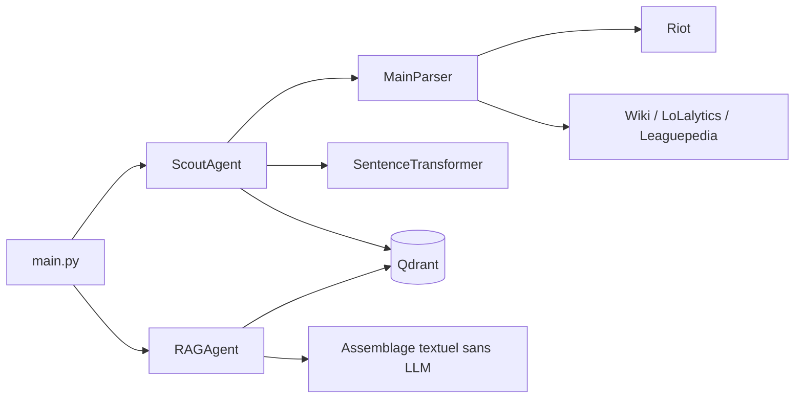
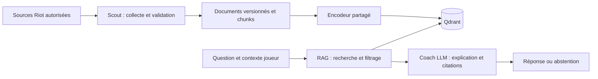
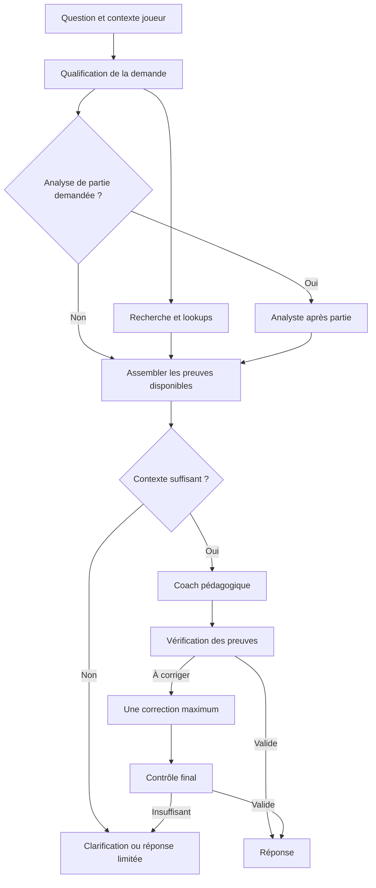

# Architecture et responsabilités

## Flux actuel

Scout conserve aussi une méthode de recherche : la séparation ingestion/retrieval
reste incomplète. Les cinq collections déclarées sont `nexusmind_champions`,
`nexusmind_matchups`, `nexusmind_meta`, `nexusmind_players` et
`nexusmind_game_states`. Leur déclaration ne garantit pas leur contenu.

## Cible progressive

Deux parcours séparés : ingestion hors requête et réponse au joueur. Une
question ne doit pas déclencher implicitement la réindexation du corpus.

| Composant | Responsabilité | Contrat cible |
| --- | --- | --- |
| Parsers/adaptateurs | Transport Riot et conversion de schémas | Donnée validée ou erreur typée, sans décision pédagogique |
| Scout | Collecter, normaliser, dédupliquer et indexer | Rapport d'ingestion : succès, rejets, version et identifiants |
| RAG | Résoudre collection, encoder, filtrer, sélectionner | Passages avec identifiant, texte, source, patch et score |
| Coach | Expliquer à partir du contexte et du niveau du joueur | Réponse, citations, limites, exercice concret ; abstention si contexte insuffisant |
| Orchestrateur futur | Enchaîner les étapes et gérer l'état/les erreurs | État typé, transitions bornées, traces et budget |

Garder `core/schema/` indépendant des SDK HTTP, du LLM et de Qdrant. Injecter
clients, encodeur, horloge et générateur là où nécessaire. Un service ne doit
pas télécharger un modèle ou appeler Riot simplement parce qu'on importe son module.

La configuration cible doit centraliser URL Qdrant, collection, version du corpus,
modèle et révision d'embedding, locale, routages Riot et paramètres du LLM.
Les noms et valeurs de cette configuration ne deviennent un contrat utilisable
qu'après implémentation et tests.

## Contrats de qualité

- Même modèle, révision, dimension et prétraitement entre ingestion et recherche.
  Tout changement incompatible crée une nouvelle collection et une réindexation.
- Identifiant déterministe fondé sur source, version, langue, entité et chunk.
  Le même lot rejoué ne crée pas de doublons ; deux patches restent distinguables.
- Conserver le texte indexé et sa provenance. Pour une question sur les sorts,
  un passage contenant seulement le nom du champion ne suffit pas.
- Réserver la recherche vectorielle aux passages ; récupérer un chiffre ou un
  identifiant exact par lookup structuré quand c'est plus fiable.
- Distinguer `ok`, `no_results`, `source_unavailable`, `embedding_unavailable`
  et `generation_failed` dans les futurs résultats, au lieu de convertir toute
  erreur en liste vide.
- Traiter les textes récupérés comme des données non fiables : leurs instructions
  ne remplacent jamais celles du Coach. Limiter taille du contexte et outils.

## Apprentissage multi-agents

Commencer avec des fonctions/services testables et un pipeline séquentiel. Après
une baseline mesurée, les envelopper dans un graphe LangGraph pour apprendre
l'état partagé, les transitions, retries bornés et traces. Aucun appel LLM
supplémentaire sans rôle et critère mesurable. Conserver la baseline simple pour
comparer pertinence, latence et coût. Le choix de LangGraph comme cible s'appuie
sur la dépendance déjà déclarée ; son intégration reste à faire.

## Architecture validée : stockage et recherche

La direction ci-dessous a été validée par le propriétaire le 31 octobre 2026.
Elle précise la cible, sans annoncer une implémentation disponible. Voir
[ADR-0002](decisions/0002-rag-orchestration.md).

| Stockage cible | Contenu | Usage |
| --- | --- | --- |
| JSON versionné | Réponses Riot brutes et objets normalisés | Rejouer une ingestion et vérifier une information |
| SQLite | Entités, versions, rapports d'ingestion ; plus tard parties et métriques | Lookups exacts et suivi des traitements |
| Qdrant | Passages textuels et provenance | Recherche sémantique |

Les données joueur ne sont pas committées avec les fixtures ou le code. Leur
versionnement signifie traçabilité interne, avec conservation et suppression
définies, pas publication sur GitHub.

Construire un passage par sort/passif ou objet, puis par section de note de patch
quand cette source sera intégrée. Le passage doit être compréhensible seul :
nom du champion ou objet, section, texte utile et provenance.

Commencer avec une collection de connaissances par génération compatible du
schéma et de l'encodeur, filtrée par entité, patch et langue. Garder les données
personnelles séparées. Les collections actuelles `nexusmind_*` restent l'existant ;
la migration doit créer et valider une nouvelle collection avant bascule.

Qualifier les noms et l'intention, faire un lookup structuré pour une valeur
exacte, rechercher les passages explicatifs, puis assembler les preuves. Démarrer
avec filtres et recherche vectorielle ; ajouter le lexical/hybride uniquement
si le jeu d'évaluation démontre un besoin sur les noms et termes précis.

## Orchestration LangGraph cible

Le Scout travaille hors requête. Le graphe de réponse ne réindexe pas le corpus.
Les branches connaissance et analyse de partie ne sont parallélisées que si
elles sont indépendantes ; elles se rejoignent avant la génération.

Le branchement Analyste reste désactivé tant que Match-v5 n'est pas implémenté.
Chaque nœud reçoit les champs nécessaires et retourne un résultat typé. État
partagé cible : `question`, `player_context`, `intent`, `entities`,
`requested_patch`, `retrieved_evidence`, `match_metrics`, `draft_answer`,
`validation_issues`, `final_answer`. Borner appels d'outils, recherches, retries,
temps total et contexte ; après une correction échouée, limiter la réponse ou
s'abstenir. Une panne technique n'est pas une absence de connaissance.

| Rôle | Décision / tâche | Usage du LLM | Priorité |
| --- | --- | --- | --- |
| Scout | Collecter, valider, dédupliquer et indexer | Aucun nécessaire pour les API Riot | Socle |
| Knowledge Retriever | Résoudre les entités, chercher les faits/passages | Aucun nécessaire au départ | Socle |
| Coach pédagogique | Expliquer selon le niveau et proposer un exercice | Oui | Premier agent LLM |
| Analyste après partie | Calculer puis interpréter les métriques et événements | Calculs Python, interprétation éventuellement LLM | Après la baseline |
| Vérificateur des preuves | Vérifier références, soutien des affirmations et contradictions | Contrôles déterministes, puis LLM si utile | Progressif |

Le Coach produit une réponse directe, les faits/observations utilisés, une
explication adaptée, les limites et hypothèses, un exercice concret et les
sources avec patch. Les citations doivent pointer vers les preuves récupérées.

## Extensions d'agents

- **Planificateur de progression** : après l'Analyste, transformer les observations
  répétées en objectifs acceptés par le joueur, exercices et suivi sur ses prochaines parties.
- **Spécialiste patch** : comparer les versions par code, puis expliquer les
  conséquences possibles sur un champion ou un style de jeu.
- **Spécialistes macro/micro** : commencer par deux modes du Coach ; séparer les
  agents lorsque leurs outils, corpus et critères d'évaluation diffèrent réellement.
- **Évaluateur hors ligne** : rejouer les questions de référence durant le
  développement ; aucun appel supplémentaire dans la réponse du joueur.

Références de conception : [workflows et agents LangGraph](https://github.com/langchain-ai/docs/blob/main/src/oss/langgraph/workflows-agents.mdx),
[filtres Qdrant](https://qdrant.tech/documentation/search/filtering/) et
[requêtes hybrides](https://qdrant.tech/documentation/search/hybrid-queries/).
