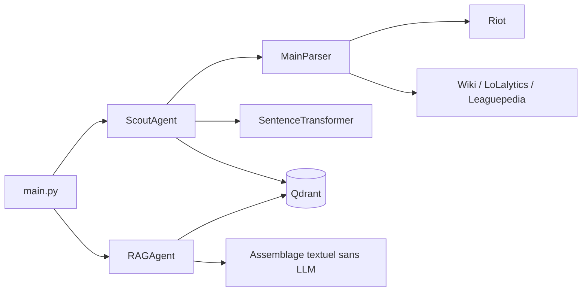
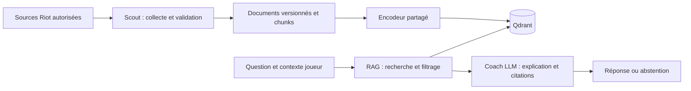

# Architecture et responsabilités

## Flux actuel

Scout conserve aussi une méthode de recherche : la séparation ingestion/retrieval
reste incomplète. Les cinq collections déclarées sont `nexusmind_champions`,
`nexusmind_matchups`, `nexusmind_meta`, `nexusmind_players` et
`nexusmind_game_states`. Leur déclaration ne garantit pas leur contenu.

## Cible progressive

Deux parcours séparés : ingestion hors requête et réponse au joueur. Une
question ne doit pas déclencher implicitement la réindexation du corpus.

| Composant | Responsabilité | Contrat cible |
| --- | --- | --- |
| Parsers/adaptateurs | Transport Riot et conversion de schémas | Donnée validée ou erreur typée, sans décision pédagogique |
| Scout | Collecter, normaliser, dédupliquer et indexer | Rapport d'ingestion : succès, rejets, version et identifiants |
| RAG | Résoudre collection, encoder, filtrer, sélectionner | Passages avec identifiant, texte, source, patch et score |
| Coach | Expliquer à partir du contexte et du niveau du joueur | Réponse, citations, limites, exercice concret ; abstention si contexte insuffisant |
| Orchestrateur futur | Enchaîner les étapes et gérer l'état/les erreurs | État typé, transitions bornées, traces et budget |

Garder `core/schema/` indépendant des SDK HTTP, du LLM et de Qdrant. Injecter
clients, encodeur, horloge et générateur là où nécessaire. Un service ne doit
pas télécharger un modèle ou appeler Riot simplement parce qu'on importe son module.

La configuration cible doit centraliser URL Qdrant, collection, version du corpus,
modèle et révision d'embedding, locale, routages Riot et paramètres du LLM.
Les noms et valeurs de cette configuration ne deviennent un contrat utilisable
qu'après implémentation et tests.

## Contrats de qualité

- Même modèle, révision, dimension et prétraitement entre ingestion et recherche.
  Tout changement incompatible crée une nouvelle collection et une réindexation.
- Identifiant déterministe fondé sur source, version, langue, entité et chunk.
  Le même lot rejoué ne crée pas de doublons ; deux patches restent distinguables.
- Conserver le texte indexé et sa provenance. Pour une question sur les sorts,
  un passage contenant seulement le nom du champion ne suffit pas.
- Réserver la recherche vectorielle aux passages ; récupérer un chiffre ou un
  identifiant exact par lookup structuré quand c'est plus fiable.
- Distinguer `ok`, `no_results`, `source_unavailable`, `embedding_unavailable`
  et `generation_failed` dans les futurs résultats, au lieu de convertir toute
  erreur en liste vide.
- Traiter les textes récupérés comme des données non fiables : leurs instructions
  ne remplacent jamais celles du Coach. Limiter taille du contexte et outils.

## Apprentissage multi-agents

Commencer avec des fonctions/services testables et un pipeline séquentiel. Après
une baseline mesurée, les envelopper dans un graphe LangGraph pour apprendre
l'état partagé, les transitions, retries bornés et traces. Aucun appel LLM
supplémentaire sans rôle et critère mesurable. Conserver la baseline simple pour
comparer pertinence, latence et coût. Le choix de LangGraph comme cible s'appuie
sur la dépendance déjà déclarée ; son intégration reste à faire.
